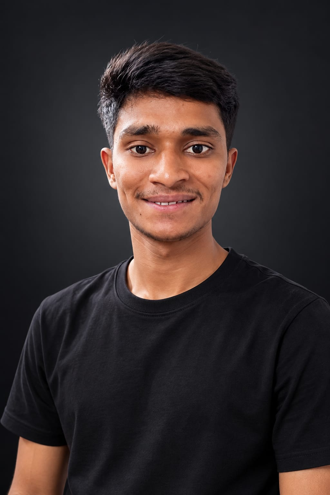

# Sayyad Hanifraza Sardar — AI Developer Portfolio

> **Futuristic Dark-Gradient Personal Portfolio Website**  
> Tailored for an **Aspiring Python Full Stack Developer** & **BCS Graduate (Grade O — Outstanding, 79.02%)**.

---

## 🌟 Visual Theme & Design Architecture

- **Theme**: Futuristic AI Dark Gradient & Glassmorphism
- **Color Palette**:
  - Deep space base: `#050711`, `#070916`, `#0c1024`
  - Neon Accents: Electric Blue (`#38bdf8`), Violet (`#8b5cf6`), Cyan (`#22d3ee`), Purple (`#a855f7`)
  - Translucent Glassmorphism cards with `backdrop-filter: blur(16px)` and subtle glowing borders
- **Interactive UI**:
  - Dynamic Typewriter effect cycling through developer titles
  - Interactive Python developer terminal card with syntax highlighting and floating tech badges
  - Live animated QR Attendance Scanner dashboard mockup
  - Categorized Technical Skills (Frontend, Backend, Database) without arbitrary percentages
  - Interactive Project Preview Modal
  - Client-side validated contact form with direct `mailto:` fallback
  - Optional Dark/Light theme toggle with preference persistence in `localStorage`
  - Smooth scroll-spy navigation & responsive mobile drawer menu
  - Ambient constellation particles with reduced-motion accessibility support

---

## 📁 Project Directory Structure

```text
Portfilo ai/
├── index.html                 # Main semantic HTML5 webpage with all sections
├── style.css                  # Complete pure CSS3 stylesheet & design tokens
├── script.js                  # Vanilla JavaScript for animations, navigation, and modal
├── 404.html                   # Custom futuristic 404 error page matching theme
├── README.md                  # Complete documentation and deployment guide
└── assets/
    ├── favicon.svg            # Custom neon "HS." brand favicon
    ├── Sayyad_Hanifraza_Sardar_Resume.pdf  # (Place your resume PDF here)
    └── images/
        ├── og-preview.svg     # Social media OpenGraph preview image
        └── (Place your project screenshots / profile photo here)
```

---

## 🚀 How to Run Locally

You can run this portfolio in any browser using several convenient methods:

### Method 1: Direct File Launch (No server needed)
Simply double-click `index.html` or right-click `index.html` → **Open with** → **Google Chrome** / **Microsoft Edge** / **Firefox**.

### Method 2: Python Built-in HTTP Server (Recommended)
Since you are a Python developer, use Python's built-in server:
```bash
# In the project directory:
python -m http.server 3000
```
Then open [http://localhost:3000](http://localhost:3000) in your browser.

### Method 3: VS Code Live Server
1. Open the `Portfilo ai` folder in **VS Code**.
2. Install the **Live Server** extension (by Ritwick Dey).
3. Right-click `index.html` and click **"Open with Live Server"**.

---

## ✏️ How to Personalize Your Information

### 1. Adding Your Real Resume PDF
1. Save your resume PDF as:
   ```text
   Sayyad_Hanifraza_Sardar_Resume.pdf
   ```
2. Put the file inside the `assets/` folder:
   ```text
   Portfilo ai/assets/Sayyad_Hanifraza_Sardar_Resume.pdf
   ```
3. When users click **Resume** on the navbar, it will automatically download your PDF.

### 2. Updating Social Profile Links (GitHub & LinkedIn)
Open `index.html` and search for `https://github.com` and `https://linkedin.com`:
- Replace `https://github.com` with your real profile URL (e.g., `https://github.com/your-username`).
- Replace `https://linkedin.com` with your real profile URL (e.g., `https://linkedin.com/in/your-username`).

### 3. Adding a Profile Picture
If you would like to display your personal photo in the Hero section or About section:
1. Save your image into `assets/images/sayyad.jpg`.
2. In `index.html`, inside the Hero or About card, you can add:
   ```html
   
   ```

### 4. Updating Project Demo & Repository Links
In `index.html`, inside `<section id="projects">`:
- Update the `href="https://github.com"` link on the **GitHub Code** button to your actual project repository.

---

## 🌐 Free Deployment Instructions

### Option 1: Deploy to Netlify (Drag and Drop in 30 seconds)
1. Go to [https://app.netlify.com/drop](https://app.netlify.com/drop).
2. Drag and drop the whole `Portfilo ai` folder directly into the browser.
3. Netlify will instantly provide a live HTTPS URL (e.g., `sayyadhanif-portfolio.netlify.app`).
4. (Optional) In Site Settings, you can configure your own free custom subdomain or custom domain.

### Option 2: Deploy to Vercel
1. Install Vercel CLI (optional) or push this folder to a GitHub repository.
2. Go to [https://vercel.com](https://vercel.com) and log in with GitHub.
3. Click **"Add New Project"** and import your repository.
4. Framework Preset: **Other** (Root directory: `./`).
5. Click **"Deploy"**.

### Option 3: Deploy to GitHub Pages (Free forever)
1. Initialize git in the folder:
   ```bash
   git init
   git add .
   git commit -m "Initial commit of Sayyad Hanifraza Sardar portfolio"
   ```
2. Create a new repository on [GitHub](https://github.com) named `sayyad-portfolio` or `username.github.io`.
3. Push your code:
   ```bash
   git remote add origin https://github.com/<your-username>/<repo-name>.git
   git branch -M main
   git push -u origin main
   ```
4. On GitHub, go to **Settings** → **Pages** → under **Branch**, choose `main` and `/root`, then click **Save**.
5. Your portfolio is live at `https://<your-username>.github.io/<repo-name>/`.

---

## 🎯 Candidate Highlights Included in Portfolio

- **Candidate Name**: Sayyad Hanifraza Sardar
- **Target Role**: Aspiring Python Full Stack Developer
- **Academic Degree**: Bachelor of Computer Science (BCS)
- **Academic Score**: Final-Year Percentage: **79.02%**
- **Academic Grade**: **Grade: O — Outstanding**
- **Core Stacks**:
  - **Backend**: Python, Django, Flask
  - **Frontend**: HTML5, CSS3, JavaScript, React.js
  - **Database**: SQL, MySQL
- **Featured Project**: QR Code-Based Attendance Management System (Python, Flask, HTML, CSS, JavaScript, MySQL)
- **Contact Details**: 
  - Email: `sayyadhanif76@gmail.com`
  - Phone: `+91 7378709480`
